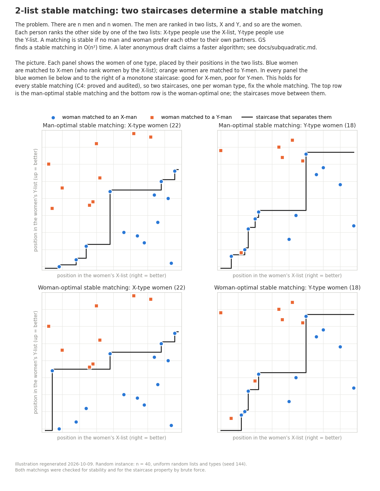

# Two-list stable matching

Code, proofs, and small test instances for strict, complete stable matching when
each side uses two master lists. The input has linear size. A stable matching
has no pair who both prefer each other to their assigned partners.

Research done with AI agents (Claude and GPT models).

## Results and limits

- **D1/D2 — proved, independently audited (P, A+):** each rotation changes the
  number of X-man/X-woman pairs by one. There are at most
  `min(|MX|, |MY|, |WX|, |WY|) <= floor(n/2)` rotations and at most `2^floor(n/2)`
  stable matchings. The bound is tight. See the [proof](docs/rotations.md).
- **F4, C4, C6 — proved, audited with the C6 scope limit (P, A+ / A~):** stable
  matchings have greedy structure and monotone label boundaries. The partner
  types of one woman type admit at most one stable completion. A proposed
  completion still needs a final stability check.
- **C9/C11 — proved, audited with stated costs (P, A~ / A+):** compressed fixed
  point methods solve classes with few type runs or list breakpoints. The
  portfolio implementation as a whole is tested, not independently audited.
- **B11/B12/B14 — proved, audited with model limits (P, A+ / A~):** explicit
  families force quadratic work for specified proposal and unit-charge models.
  These bounds do not apply to every stable-matching algorithm.
- **Anonymous draft — structure proved and audited (P, A+); runtime unaudited (A0):**
  an anonymous author claims deterministic `O(n^2 sqrt(log log n / log n))` time.
  The structural projection theorem and unique minimum-seam characterization
  were independently confirmed on 2026-10-09. We include
  the [draft](paper/twolist-subquadratic.pdf) and a [scope note](docs/subquadratic.md).
  Our cover implementation is a finite correctness check, not that fast algorithm.

The internal research found no general subquadratic algorithm and no general
lower bound. The later anonymous draft is separate work. See the
[result summary and status key](docs/summary.md) and [failed routes](docs/dead-routes.md).



## Build and test

Requirements: Linux, GNU make, a C++17 compiler, and Python 3 (standard library).
No package installation is needed for the solvers or tests.

```sh
make
make test
build/reference solve instances/twin.txt build/matching.txt
build/reference check instances/twin.txt build/matching.txt
build/best instances/weave.txt build/matching.txt
python3 generators/generate.py ltwin 25 build/ltwin.txt
```

`make test` uses fixed seeds, brute force on small inputs, independent rotation
checks, label checks, and solver comparisons. It is intended to finish within two
minutes on a usual Linux development machine. `make test-full-cover` runs the
original 3,000-instance cover experiment separately. The optional figure script
needs matplotlib: `python3 docs/figures/staircases.py`.

## Files and formats

- `src/reference/`: instance parser, reference proposal solver, stability checks,
  random generation, and brute force.
- `src/portfolio/`: structured methods and the portfolio driver `best`.
- `src/rbgs/`: experimental run-buffer solver; prototype costs differ from theorem costs.
- `generators/`: named families, boundary weave, and decoy/glue transformations.
- `verify/`: independent standard-library checks and a simple cover implementation.
- `instances/`: six small generated examples; [format and commands](docs/code.md).
- `docs/`: result scope, rotation proof, and figure.
- `paper/`: anonymous external draft.

## Credit and license

The code and our documentation use the [MIT license](LICENSE).
The external draft `paper/twolist-subquadratic.pdf` retains its anonymous author's
rights and is **excluded** from that license.

Independent notes by an anonymous researcher overlap the greedy-label result F4,
the failures of label closure, and the refutation of F7. No text or code from
those notes is included. The anonymous draft is credited to an anonymous author.
